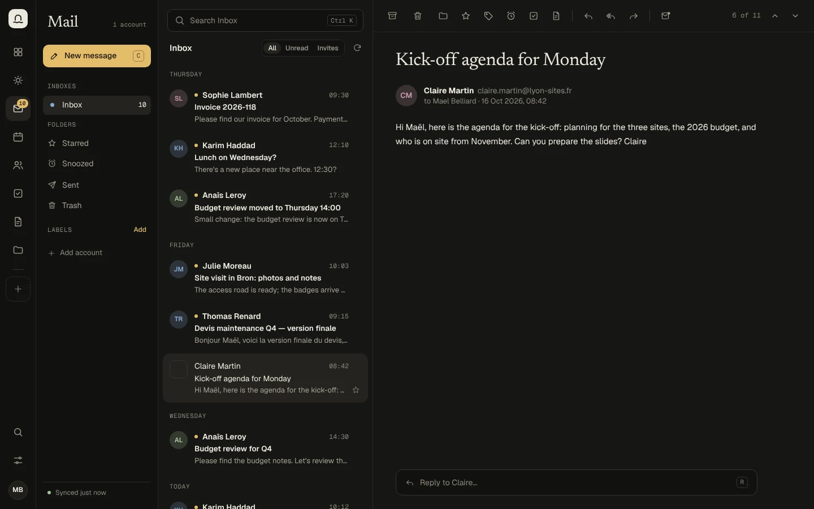
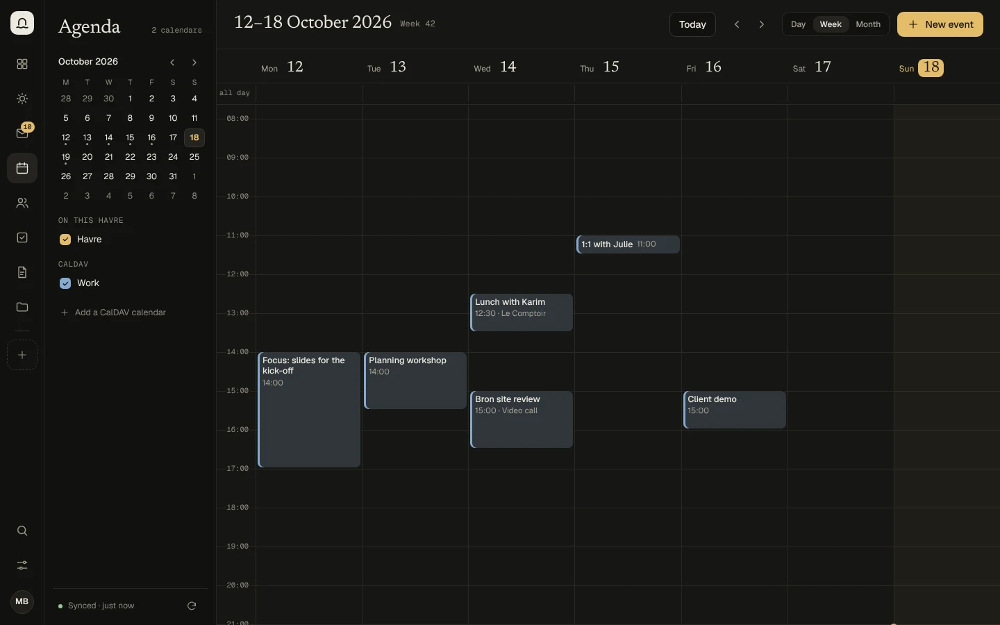
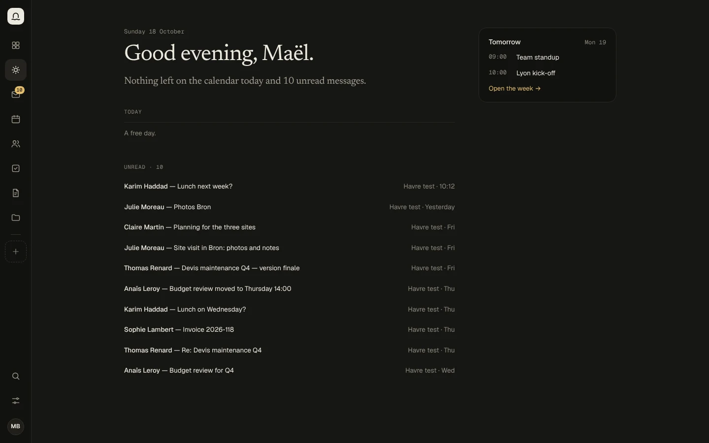
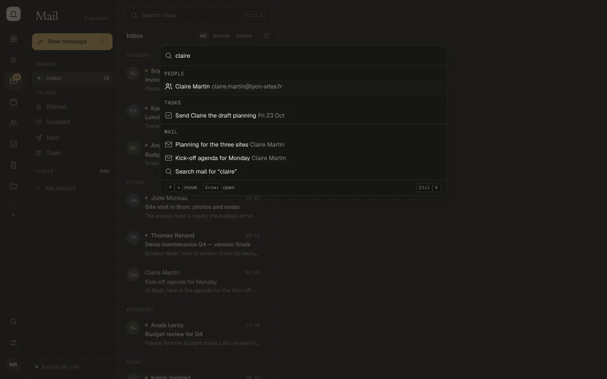

<div align="center">


# Havre

**Your mail, calendars and everyday apps — self-hosted, private, and working together.**

[](https://github.com/maelbel/havre/actions/workflows/ci.yml)
[](LICENSE)
[](https://www.rust-lang.org)


[Installation](docs/installation.md) · [User guide](docs/user-guide.md) · [Roadmap](docs/ROADMAP.md) ·
[Contributing](CONTRIBUTING.md)

<picture>
  <source media="(prefers-color-scheme: light)" srcset="docs/assets/screenshots/mail-light.webp">
  
</picture>

</div>

## About

Havre is a self-hosted home for the apps you use every day. It brings all your mail accounts and calendars into one
calm interface, and lets the apps share what they know: the people you write to, the meetings you have, the files you
exchange. It runs on your own server as a single Rust binary with a SQLite database, talks directly to your mail and
calendar providers, and loads nothing from third-party servers.

> [!WARNING]
> Havre is in early development (0.x) and has no release yet. It is usable day to day, but expect changes — and keep
> backups (Havre makes nightly ones for you).

## Features

- **Mail**
  - Several accounts in one inbox: Microsoft 365, Gmail and any [IMAP](https://www.rfc-editor.org/rfc/rfc9051) server,
    with OAuth2 sign-in where the provider requires it
  - New mail pushed in a second (IMAP IDLE), instant local search, search by meaning with AI
  - Stars, labels, snooze, actions on several messages, undo
  - Writing with drafts saved as you type, attachments and recipient suggestions
- **Agenda**
  - Microsoft 365, Google Calendar and [CalDAV](https://www.rfc-editor.org/rfc/rfc4791) calendars side by side, plus
    Havre's own
  - Day, week and month views; meeting invitations answered straight from Mail
- **People and Today**
  - Everyone you write to or meet, with your shared mail, meetings, notes, tasks and files — no address book to keep
  - A daily overview: meetings, invitations waiting for an answer, unread mail, tasks due
- **Apps you add**
  - **Tasks** — synced with Microsoft To Do, Google Tasks and CalDAV, with reminders and quick add (“Call Thomas fri
    10:00”)
  - **Notes** — Markdown notes linked to meetings, people and emails
  - **Files** — every attachment in your mail, with copies and versions grouped
- **AI, entirely optional**
  - Summaries, reply drafts, a morning brief and an assistant that answers from your mail and calendar
  - Runs locally with [Ollama](https://ollama.com), or with OpenAI-compatible providers, Anthropic or Claude Code
  - Only *proposes* actions: nothing is sent, created or changed without your confirmation
- **Made for self-hosting**
  - Docker image, nightly backups with a recovery key, credentials encrypted at rest
  - Havre Desktop for Windows, macOS and Linux (tray, notifications, default mail app)
  - An [MCP](https://modelcontextprotocol.io) endpoint so AI tools can use your data, with your permission
  - A Ctrl+K command palette, keyboard shortcuts, dark and light themes

## Screenshots

<table>
  <tr>
    <td width="33%"></td>
    <td width="33%"></td>
    <td width="33%"></td>
  </tr>
  <tr>
    <td align="center"><sub>Agenda</sub></td>
    <td align="center"><sub>Today</sub></td>
    <td align="center"><sub>Ctrl+K</sub></td>
  </tr>
</table>

## Getting started

You need Docker with Compose:

```sh
git clone https://github.com/maelbel/havre.git
cd havre
cp .env.example .env
docker compose up -d --build
```

Open <http://localhost:9988>, choose your Havre password and add a mail account in **Settings**. Most providers only
need an email address and a password; Microsoft 365 and Google sign-in need a [one-time setup](docs/providers.md).
To look around without a mailbox, set `HAVRE_DEMO=1` in `.env`.

Building from source, configuration, HTTPS and backups are covered in the [installation guide](docs/installation.md).

## Documentation

- [Installation](docs/installation.md) — Docker, from source, configuration, HTTPS, backups and restore
- [Providers](docs/providers.md) — connecting Microsoft 365 / Outlook and Gmail / Google Workspace
- [User guide](docs/user-guide.md) — every app, keyboard shortcuts, AI, Claude Code and MCP
- [Havre Desktop](desktop/README.md) — installers, notifications, default mail app
- [Development](docs/development.md) — code layout, local development, learning Rust with the codebase

## Built with

[Rust](https://www.rust-lang.org) · [Axum](https://github.com/tokio-rs/axum) · [Tokio](https://tokio.rs) ·
[sqlx](https://github.com/launchbadge/sqlx) and SQLite · [Nuxt](https://nuxt.com), [Vue](https://vuejs.org) and [Nuxt UI](https://ui.nuxt.com) ·
[Tauri](https://tauri.app)

## Roadmap

Mail, Agenda, People, Today, Tasks, Notes, Files, AI and Havre Desktop are built. Next up: repeating events, drafts
synced to the mail server, and off-site backups. See the full [roadmap](docs/ROADMAP.md).

## Contributing

Contributions, bug reports and ideas are welcome. Please read the [contributing guide](CONTRIBUTING.md) (setup,
branches, Conventional Commits) and the [code of conduct](CODE_OF_CONDUCT.md). Notable changes are listed in
the [changelog](CHANGELOG.md).

## Security

Found a vulnerability? Please report it privately as described in the [security policy](SECURITY.md) — not in a public
issue.

## License

Havre is free software, released under the [GNU Affero General Public License v3.0 or later](LICENSE).
